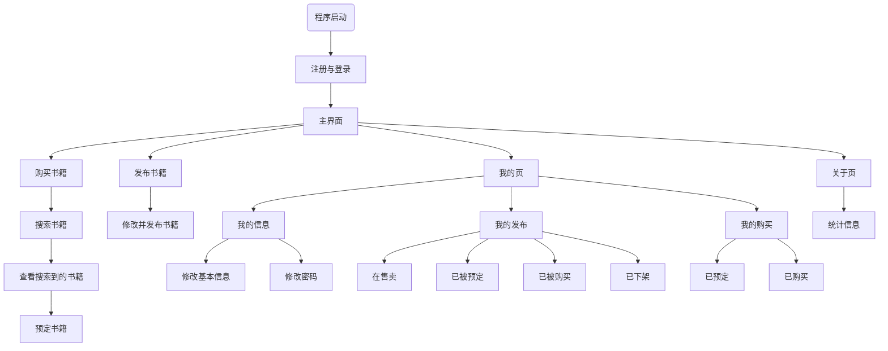

# BookEase

该项目已改为C++版, 原C语言版在[此处](https://github.com/Flmpx/BookEase/tree/b7d746571cc74b304fe7e75661ff7a69986d5f41)


## 程序运行流程图




## 项目目录结构

```txt
.
├── CMakeLists.txt              # CMake构建文件
├── LICENSE                     # 开源许可证
├── README.md                   # 本文档
├── base                        # 基础类, 结构体以及枚举等
│   ├── base.cpp
│   └── base.hpp
├── docs           
│   └── design.md               # 设计文档      
├── easyx                       # EasyX的相关头文件和静态库
│   ├── include
│   │   ├── easyx.h
│   │   └── graphics.h
│   └── lib
│       ├── libeasyx.a
│       └── libeasyxw.a
├── main.cpp                    # 程序入口
├── menu                        # 菜单
│   ├── menu.cpp
│   ├── menu.hpp
│   └── theme.hpp                                       # 配色和主题
├── process        
│   ├── about                   # 关于页 
│   │   ├── about.cpp
│   │   └── about.hpp
│   ├── buy                     # 购买书籍页
│   │   ├── buy.cpp     
│   │   └── buy.hpp
│   ├── login                   # 登录页
│   │   ├── login.cpp
│   │   └── login.hpp
│   ├── mainpage                # 首页
│   │   ├── mainpage.cpp
│   │   └── mainpage.hpp
│   ├── my                      # 我的页
│   │   ├── my.cpp
│   │   └── my.hpp
│   ├── post                    # 发布书籍页
│   │   ├── post.cpp
│   │   └── post.hpp
│   └── saveandload             # 文件操作提供的工具
│       ├── saveandload.cpp
│       └── saveandload.hpp
└── tools                       # 工具函数
    ├── cmps.hpp                                        # 排序使用的比较函数
    ├── tools.cpp
    └── tools.hpp
```


## 依赖的项目

| 依赖的项目 | 链接 |
| --- | --- |
| `flJson` | [Flmpx/flJson](https://github.com/Flmpx/flJson) |
| `EasyX` | [EasyX Graphics Library for C++](https://easyx.cn/) |