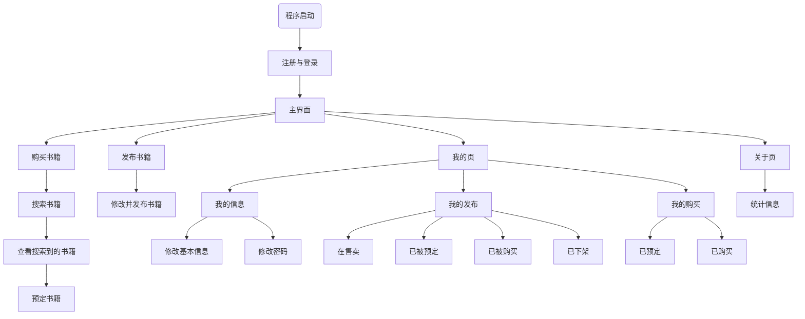

# BookEase
由于EasyX是调用Windows的图形库, 故仅Windows端可编译和运行  


该项目已改为C++版, 原C语言版在[此处](https://github.com/Flmpx/BookEase/tree/b7d746571cc74b304fe7e75661ff7a69986d5f41)


## 程序运行流程图




## 项目目录结构

```txt
├── CHANGELOG.md                        # 版本记录
├── CMakeLists.txt                      # CMake构建文件
├── LICENSE                             # 开源许可证
├── README.md                           # 本文档
├── main.cpp                            # 程序入口
├── base                                # 基础类, 结构体以及枚举等
│   ├── base.cpp
│   └── base.hpp
├── docs
│   └── design.md                       # 设计文档
├── easyx                               # EasyX图形库
│   ├── include
│   │   ├── easyx.h
│   │   └── graphics.h
│   └── lib
│       ├── libeasyx.a
│       └── libeasyxw.a
├── menu                                # 菜单工具
│   ├── menu.cpp
│   ├── menu.hpp
│   └── theme.hpp
├── process
│   ├── about                           # 关于
│   │   ├── about.cpp
│   │   └── about.hpp
│   ├── buy                             # 购买书籍
│   │   ├── buy.cpp
│   │   └── buy.hpp
│   ├── login                           # 注册与登录
│   │   ├── login.cpp
│   │   └── login.hpp
│   ├── mainpage                        # 主页
│   │   ├── mainpage.cpp
│   │   └── mainpage.hpp
│   ├── my                              # 我的页
│   │   ├── my.cpp
│   │   └── my.hpp
│   └── post                            # 发布书籍
│       ├── post.cpp
│       └── post.hpp
└── tools                               
    ├── cmps.hpp                        # 比较函数
    ├── tools.hpp                       # 工具函数
    └── src                             # 工具函数的实现文件
        ├── auth.cpp                 
        ├── change.cpp
        ├── draw.cpp
        ├── file.cpp
        ├── input.cpp
        └── print.cpp
    
```


## 构建(仅限Windows)

### 首先将仓库克隆下来  
```shell
git clone https://github.com/Flmpx/BookEase.git # 如果配置了ssh, 可用使用 git@github.com:Flmpx/BookEase.git
```

### 新建并切换到build目录  
```shell
mkdir build
cd build
```

### 使用cmake进行构建  
由于EasyX的静态库和相关的头文件在该项目中, 故CMake的构建过程只会拉取flJson仓库  
注意要使用MinGW的相关构建工具  
```shell
cmake -G "MinGW Makefiles" ..    # 如果要使用ssh来拉取BookEase的依赖库, 开启选项 BOOKEASE_USE_SSH_FOR_GIT
```


### 构建可执行文件
使用MinGW的mingw32-make来执行而不是make  
```shell
mingw32-make
```

### 大功告成

切换到 `bin/` 目录, 你会看到 `BookEase.exe` 可执行文件, 运行它!  


## 依赖的项目

| 依赖的项目 | 链接 |
| --- | --- |
| `flJson` | [Flmpx/flJson](https://github.com/Flmpx/flJson) |
| `EasyX` | [EasyX Graphics Library for C++](https://easyx.cn/) |